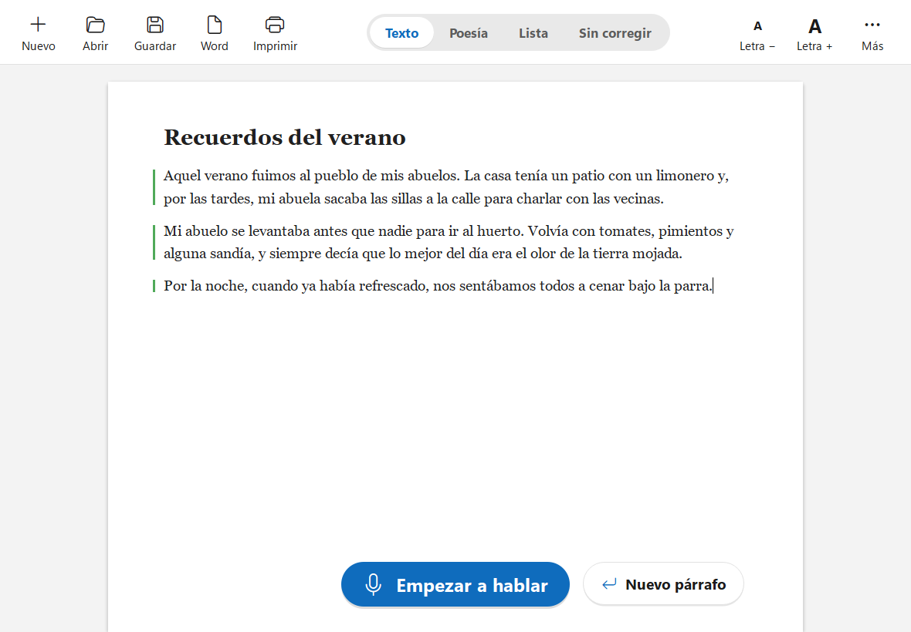

# Dictador

[English](README.md) · **Español**

Aplicación de escritorio para Windows 10/11 para **dictar por voz a un documento**, todo en el propio equipo y sin
conexión (salvo la descarga inicial de los modelos). Parakeet TDT 0.6B v3 transcribe frase a frase en la CPU y un
LLM pequeño corrige cada párrafo terminado mientras sigues hablando. Interfaz y dictado en **español e inglés**.

Está pensada para **personas mayores**: una hoja blanca como la de Word, letra grande, un botón grande para hablar
y nada más a la vista. Lo demás (ajustes, glosario, ver correcciones…) está en el botón **Más**.



## Descargar e instalar

Descarga **`Dictador-1.0-Setup.exe`** (~64 MB) desde [Releases](https://github.com/Kobayashi82/Dictator/releases/latest).

Instala para el usuario sin pedir permisos de administrador, pone el icono en el escritorio y en el menú Inicio y
hace que los documentos `.dictador` se abran con doble clic. Al abrir el programa por primera vez, un **asistente**
con letra grande:

1. da la bienvenida;
2. descarga lo necesario (voz y corrector, ~2 GB) con una sola barra de progreso;
3. prueba el micrófono;
4. explica el uso en tres pasos.

La explicación se puede volver a ver en **Más › Ayuda** (o `F1`).

## Cómo funciona

```
Micrófono → Silero VAD → frases (pausa corta) → Parakeet → editor
                       → párrafo (pausa larga) → cola → LLM → salvaguarda → editor
```

- **Hablar:** un toque del botón (o `F9`, configurable) empieza y otro para. Si se mantiene pulsado, para al
  soltarlo.
- **Texto en vivo:** mientras hablas, lo que dices aparece en cursiva gris al final del documento. No hace falta
  esperar a ninguna pausa para verlo.
- **Pausa corta** (0,8 s): cierra la frase.
- **Pausa larga** (2,5 s), «punto y aparte», `Ctrl+Intro` o parar: cierra el párrafo y lo manda al corrector.
- **Poesía:** pausas propias, más cortas: 0,35 s cierra el verso (cada uno en su línea) y 1,3 s la estrofa.
- Cada párrafo guarda el **texto original y el corregido**. Con **Más › Marcar lo que se ha corregido**, una marca
  en el margen indica su estado (azul = corrigiendo, verde = corregido, naranja = corrección descartada, morado =
  editado a mano); con un clic en ella (o con el botón derecho) se ven los cambios, se vuelve al original o se
  corrige otra vez. Si editas un párrafo a mano, el corrector ya no lo toca.
- **Modos:** Texto, Poesía, Lista y Sin corregir.
- **Órdenes de voz:** «punto y aparte», «nuevo párrafo», «nueva estrofa», «borra la última frase», «título …». En
  inglés: "new paragraph", "new stanza", "delete last sentence" / "scratch that", "title …".
- **Nombres y palabras especiales** (glosario), generales y por documento, para nombres propios y vocabulario raro.
- Tema claro y oscuro; por defecto, el de Windows.

## El corrector

En **Más › Ajustes › Corrector** se descarga (~1,3 GB) y se elige dónde trabaja: **Procesador** o **Tarjeta
gráfica** (Vulkan). Es Qwen3.5 2B con llama-server; Dictador arranca y para el servidor solo. Medido en un Ryzen 7
7800X3D: un párrafo de 63 palabras en ~2 s en el procesador.

También puede usar un **servidor externo**: cualquier endpoint compatible con OpenAI, en el mismo equipo o en otro
de la red. Se configura en `%APPDATA%\Dictador\config.json` (`llm_base_url`, `llm_model`, `llm_api_key`, con
`managed_enabled: false`) y entonces aparece como tercera opción en Ajustes.

| Servidor | URL base típica | Modelo |
|---|---|---|
| llama-swap | `http://localhost:8080/v1` | el nombre de la entrada (ver [llama-swap.yaml](docs/llama-swap.yaml)) |
| llama-server | `http://localhost:8080/v1` | cualquiera (sirve un solo modelo) |
| Ollama | `http://localhost:11434/v1` | `qwen3.5-4b:latest`, etc. |
| LM Studio | `http://localhost:1234/v1` | el identificador que muestra LM Studio |

Para un servidor en otro equipo basta con cambiar `localhost` por su IP (Ollama necesita `OLLAMA_HOST=0.0.0.0` para
escuchar fuera de localhost). Con `llm_disable_thinking` (activado por defecto), cada petición lleva
`reasoning_effort: "none"` (Ollama) y `chat_template_kwargs: {"enable_thinking": false}` (llama-server); si el
servidor rechaza esos campos, Dictador reintenta sin ellos y añade `/no_think` al prompt. Recomendado: **Qwen3.5 2B**
Q4_K_M en un equipo modesto; Qwen3.5 4B si hay margen.

**Titubeos:** al dictar uno se corrige sobre la marcha («dejaban su paso a su paso», «a las ocho, no, a las nueve»).
Lo que vale es lo último que se dijo. Los casos claros (repeticiones, autocorrecciones con «no», «eh», «digo»… en
medio, muletillas sueltas) se arreglan por reglas antes de llamar al corrector, porque los modelos pequeños suelen
borrar la versión buena en vez de la descartada. En poesía no se toca nada de esto.

Una **salvaguarda** rechaza las correcciones que cambian demasiado el texto (distancia de edición, longitud, número
de versos) y limpia los preámbulos típicos («Aquí tienes…»). Si el corrector falla o no responde, el dictado sigue
y el párrafo se queda con el texto de Parakeet; se puede reintentar después desde **Más**.

## Archivos

- Documento `.dictador` (JSON): todos los párrafos con original, corrección y estado. Al reabrirlo, el dictado sigue
  al final.
- Guardar como Word (`Ctrl+E`), exportar a `.md` y `.txt`; importar `.txt` y `.md`.
- Copia de recuperación cada 60 s.
- Modelos en `%LOCALAPPDATA%\Dictador\models`; ajustes en `%APPDATA%\Dictador\config.json`.

## Atajos

| Atajo | Acción |
|---|---|
| `F9` | Empezar / parar de hablar (configurable) |
| `Ctrl+Intro` | Nuevo párrafo |
| `Ctrl+N` / `Ctrl+O` / `Ctrl+S` | Nuevo / abrir / guardar |
| `Ctrl+E` | Guardar como documento de Word |
| `Ctrl+P` | Imprimir |
| `Ctrl++` / `Ctrl+-` | Letra más grande / más pequeña |
| `F1` | Ver la explicación otra vez |
| `Ctrl+,` | Ajustes |

## Desarrollo

Python 3.12, PySide6 y [uv](https://docs.astral.sh/uv/).

```sh
uv sync
uv run dictador                          # la app
uv run dictador --fake-asr --fake-llm    # sin micrófono, modelos ni LLM
uv run dictador --transcribe audio.wav   # diagnóstico: VAD + Parakeet sobre un .wav de 16 kHz mono
uv run pytest                            # tests
```

Ajustes › Mostrar las opciones avanzadas › «Guardar el audio para diagnóstico» graba el audio y la probabilidad de
voz de cada trama en `%LOCALAPPDATA%\Dictador\diagnostico`, para repetirlo después con `--transcribe`.

### Generar el instalador

```sh
uv run python installer/build.py
```

Hace `dist/Dictador/` con PyInstaller (sin modelos) y lo empaqueta con Inno Setup 6
(`winget install JRSoftware.InnoSetup`) en `dist/Instalar Dictador.exe`. El script del instalador está en
[installer/dictador.iss](installer/dictador.iss).

## Licencias de los modelos

Parakeet TDT 0.6B v3 (NVIDIA, CC-BY-4.0, versión ONNX de istupakov), Silero VAD (MIT), Qwen3.5 2B (Apache-2.0,
GGUF de unsloth), llama.cpp (MIT).
