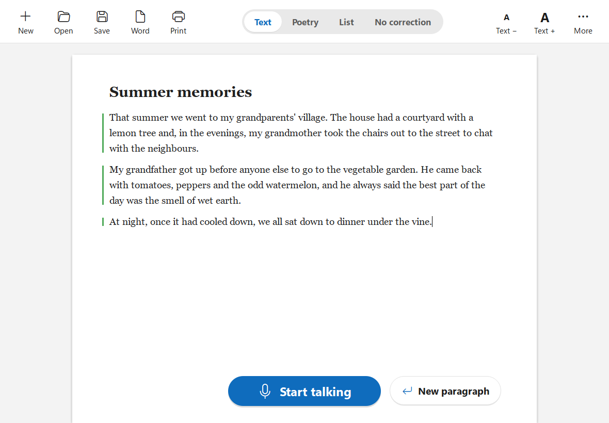

# Dictador

**English** · [Español](README.es.md)

A Windows 10/11 desktop app for **dictating into a document by voice**, entirely on your own computer and offline
(apart from the one-time model download). Parakeet TDT 0.6B v3 transcribes sentence by sentence on the CPU, and a
small LLM corrects each finished paragraph while you keep talking. Interface and dictation in **English and
Spanish**.

It is designed for **older people**: a white page like Word, large text, one big button to talk and nothing else in
sight. Everything else (settings, glossary, reviewing corrections…) lives under the **More** button.



## Download and install

Download **`Dictador-1.0-Setup.exe`** (~64 MB) from [Releases](https://github.com/Kobayashi82/Dictator/releases/latest).

It installs for the current user without asking for administrator rights, adds icons to the desktop and Start
menu, and makes `.dictador` documents open with a double click. The first time the app opens, a **wizard** with
large text:

1. says hello;
2. downloads what it needs (voice and corrector, ~2 GB) with a single progress bar;
3. tests the microphone;
4. explains how to use it in three steps.

The explanation can be shown again with **More › Help** (or `F1`).

## How it works

```
Microphone → Silero VAD → sentences (short pause) → Parakeet → editor
                        → paragraph (long pause)  → queue → LLM → safeguard → editor
```

- **Talk:** one tap of the button (or `F9`, configurable) starts and another stops. If you hold it down, dictation
  stops when you let go.
- **Live text:** while you speak, what you are saying appears in grey italics at the end of the document. No need
  to wait for a pause to see it.
- **Short pause** (0.8 s): closes the sentence.
- **Long pause** (2.5 s), "new paragraph", `Ctrl+Enter` or stopping: closes the paragraph and sends it to the
  corrector.
- **Poetry:** its own, shorter pauses: 0.35 s closes the line (each on its own line) and 1.3 s the stanza.
- Each paragraph keeps the **original and the corrected text**. With **More › Highlight what was corrected**, a
  mark in the margin shows its state (blue = correcting, green = corrected, orange = correction discarded, purple =
  edited by hand); click it (or right-click) to see the changes, revert to the original or correct it again. Once you edit a paragraph by hand, the corrector leaves it
  alone.
- **Modes:** Text, Poetry, List and No correction.
- **Voice commands:** "new paragraph", "new stanza", "delete last sentence" / "scratch that", "title …". In
  Spanish: «punto y aparte», «nuevo párrafo», «nueva estrofa», «borra la última frase», «título …».
- **Special names and words** (glossary), general and per document, for proper names and unusual vocabulary.
- Light and dark theme, following Windows by default.

## The corrector

In **More › Settings › Corrector** you download it (~1.3 GB) and choose where it runs: **Processor** or **Graphics
card** (Vulkan). It is Qwen3.5 2B with llama-server; Dictador starts and stops the server by itself. Measured on a
Ryzen 7 7800X3D: a 63-word paragraph in ~2 s on the processor.

It can also use an **external server**: any OpenAI-compatible endpoint, on this computer or another one on the
network. It is set in `%APPDATA%\Dictador\config.json` (`llm_base_url`, `llm_model`, `llm_api_key`, with
`managed_enabled: false`), and then it appears as a third option in Settings.

| Server | Typical base URL | Model |
|---|---|---|
| llama-swap | `http://localhost:8080/v1` | the entry name (see [llama-swap.yaml](docs/llama-swap.yaml)) |
| llama-server | `http://localhost:8080/v1` | any (it serves a single model) |
| Ollama | `http://localhost:11434/v1` | `qwen3.5-4b:latest`, etc. |
| LM Studio | `http://localhost:1234/v1` | the identifier LM Studio shows |

For a server on another computer, replace `localhost` with its IP (Ollama needs `OLLAMA_HOST=0.0.0.0` to listen
beyond localhost). With `llm_disable_thinking` (the default), each request carries `reasoning_effort: "none"`
(Ollama) and `chat_template_kwargs: {"enable_thinking": false}` (llama-server); if the server rejects them, Dictador
retries without them and adds `/no_think` to the prompt. Recommended: **Qwen3.5 2B** Q4_K_M on a modest machine,
Qwen3.5 4B if there is room.

**Hesitations:** when dictating, people correct themselves on the fly ("at eight, no, at nine"). What counts is the
last thing said. Clear cases (repetitions, self-corrections with "no", "I mean", "uh" in between, stray fillers) are
fixed by rules before calling the corrector, because small models tend to delete the good version instead of the
discarded one. Poetry is left untouched.

A **safeguard** rejects corrections that change the text too much (edit distance, length, number of lines) and
strips the usual preambles ("Here is…"). If the corrector fails or does not answer, dictation carries on and the
paragraph keeps Parakeet's text; it can be retried later from **More**.

## Files

- `.dictador` document (JSON): every paragraph with its original, correction and status. When reopened, dictation
  continues at the end.
- Save as Word (`Ctrl+E`), export to `.md` and `.txt`; import `.txt` and `.md`.
- Recovery autosave every 60 s.
- Models in `%LOCALAPPDATA%\Dictador\models`; settings in `%APPDATA%\Dictador\config.json`.

## Shortcuts

| Shortcut | Action |
|---|---|
| `F9` | Start / stop talking (configurable) |
| `Ctrl+Enter` | New paragraph |
| `Ctrl+N` / `Ctrl+O` / `Ctrl+S` | New / open / save |
| `Ctrl+E` | Save as Word document |
| `Ctrl+P` | Print |
| `Ctrl++` / `Ctrl+-` | Larger / smaller text |
| `F1` | Show the explanation again |
| `Ctrl+,` | Settings |

## Development

Python 3.12, PySide6 and [uv](https://docs.astral.sh/uv/).

```sh
uv sync
uv run dictador                          # the app
uv run dictador --fake-asr --fake-llm    # without microphone, models or LLM
uv run dictador --transcribe audio.wav   # diagnostics: VAD + Parakeet on a 16 kHz mono .wav
uv run pytest                            # tests
```

Settings › Show advanced options › "Save the audio for diagnostics" records the audio and the per-frame voice
probability in `%LOCALAPPDATA%\Dictador\diagnostico`, to replay it later with `--transcribe`.

### Building the installer

```sh
uv run python installer/build.py
```

Builds `dist/Dictador/` with PyInstaller (without models) and packs it with Inno Setup 6
(`winget install JRSoftware.InnoSetup`) into `dist/Instalar Dictador.exe`. The installer script is
[installer/dictador.iss](installer/dictador.iss).

## Model licences

Parakeet TDT 0.6B v3 (NVIDIA, CC-BY-4.0, ONNX version by istupakov), Silero VAD (MIT), Qwen3.5 2B (Apache-2.0,
GGUF by unsloth), llama.cpp (MIT).
